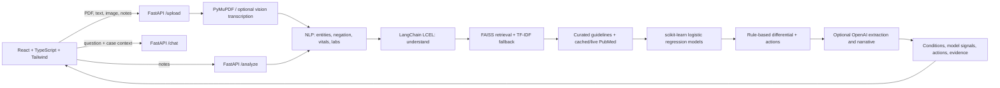

# Clarity: Multimodal Clinical Decision Support

Clarity is a research prototype that accepts clinical notes and reports, extracts structured findings, retrieves reference material, and presents tabular model signals for clinician review. It is not a diagnostic system or a substitute for clinical judgement.

## Architecture



## Assignment Coverage

| Requirement | Implementation and notes |
|---|---|
| PDF, text, optional images | `backend/app/main.py`: `POST /upload`; PyMuPDF text extraction, TXT/Markdown, PNG/JPEG/WebP. Image-only interpretation requires a working vision API; with typed notes, unavailable vision falls back to rules mode. |
| NLP and LLM extraction | `backend/app/nlp.py`: dictionary entity extraction, negation, lab/vitals parsing. `backend/app/agent.py`: optional GPT JSON extraction, summary, and chat. No BioBERT or LLaMA adapter is included. |
| Diabetes and heart risk models | `backend/app/ml.py`: scikit-learn logistic regression for Pima diabetes and UCI Cleveland heart disease. `/models` reports cohort and exploratory metrics. Heart prediction requires all 13 model fields; the diabetes model requires Glucose, BMI, and Age. |
| RAG and PubMed | `backend/app/rag.py`: FAISS inner-product search over curated guideline records and optional cached PubMed abstracts, plus live NCBI E-utilities. OpenAI embeddings are optional; local TF-IDF is the no-key fallback. |
| Three-step agent | `backend/app/agent.py`: LangChain LCEL pipeline: understand patient, fetch evidence, generate recommendation. The returned `agent_trace` exposes the three steps. |
| Results | `/analyze` and `/upload` return possible conditions, model probabilities/signals, clinician-review actions, evidence, extracted entities, and a safety disclaimer. These are not validated personal risk estimates. |
| React application | `frontend/src`: React, TypeScript, Tailwind, sample cases, file/notes intake, structured model inputs, results, and evidence-backed chat. |
| Deliverable endpoints | `POST /upload`, `POST /analyze`, `POST /chat`, `GET /health`, `GET /models`, and `GET /evidence`; interactive API docs at `/docs`. |
| Deployment targets | `render.yaml` defines the Docker API service. Vercel uses `frontend/vercel.json`; set `VITE_API_URL` to the deployed API origin and configure API `CORS_ORIGINS`. No live deployment URLs are claimed here. |

With no usable OpenAI service, text, machine-readable PDFs, chat, RAG, and model rules work locally. If a configured OpenAI request fails, the agent falls back to rules/retrieved passages. Image-only uploads cannot be interpreted in rules mode and return a clear error; provide notes alongside the image to continue without vision.

## Local Setup

Prerequisites: Python 3.10 or newer and Node.js 18 or newer. Run commands from the repository root unless shown otherwise.

### Windows PowerShell

```powershell
.\setup.ps1
.\start.ps1
```

The setup script creates `backend/.venv`, installs Python and frontend dependencies, and copies `backend/.env.example` to `backend/.env` only when no `.env` already exists. The start script opens the API at `http://localhost:8000` and UI at `http://localhost:5173`.

### macOS / Linux

```bash
cd backend
python3 -m venv .venv
source .venv/bin/activate
python -m pip install -r requirements-dev.txt
cp .env.example .env
uvicorn app.main:app --reload --port 8000
```

In a second terminal:

```bash
cd frontend
npm install
npm run dev
```

The UI defaults to `http://localhost:5173`; the API defaults to `http://localhost:8000`. For Docker Compose, copy `backend/.env.example` to `backend/.env`, then run `docker compose up --build`; the UI is served at `http://localhost:8080`.

## Environment Variables

| Variable | Default | Purpose |
|---|---|---|
| `OPENAI_API_KEY` | unset | Optional GPT extraction/chat, image transcription, summaries, and embeddings. Never commit this value. |
| `OPENAI_MODEL` | `gpt-4o-mini` | Chat/completion model. |
| `OPENAI_VISION_MODEL` | `gpt-4o-mini` | Optional non-diagnostic image transcription model. |
| `OPENAI_EMBED_MODEL` | `text-embedding-3-small` | Optional evidence embedding model. |
| `OPENAI_TIMEOUT` | `45` seconds | OpenAI client timeout. |
| `EMBEDDINGS` | `auto` | Use OpenAI embeddings when available; set to `tfidf` to force local embeddings. |
| `PUBMED_LIVE` | `true` | Enable best-effort live NCBI PubMed lookups; set `false` for offline mode. |
| `NCBI_API_KEY` | unset | Optional NCBI E-utilities rate-limit key. |
| `CORS_ORIGINS` | localhost Vite origins | Comma-separated exact browser origins allowed by FastAPI. Set to the Vercel origin in production. |
| `PORT` | `8000` | Render/container HTTP port; Render supplies this automatically. |
| `VITE_API_URL` | `http://localhost:8000` | Frontend build-time API origin. Set this in Vercel before building. |

## API Reference

All response examples are abbreviated; the API also returns trace, limitations, and supporting metadata.

### `GET /health`

Returns service state, LLM configuration status, vector-store/embedder names, PubMed setting, evidence count, model availability, and agent pipeline label. This is a readiness check; startup builds the local index and loads/trains models first.

### `POST /analyze`

```bash
curl -X POST http://localhost:8000/analyze \
	-H 'Content-Type: application/json' \
	-d '{"text":"Fatigue and thirst. Glucose 142 mg/dL, BMI 31, age 52."}'
```

JSON fields: required `text` (up to 30,000 characters) and optional numeric `risk_features` map. Response includes `possible_conditions`, `risks`, `risk_score`, `recommended_actions`, `evidence`, `agent_trace`, and `disclaimer`.

### `POST /upload`

Multipart form fields: optional `file`, optional `notes`, optional JSON-object `risk_features`. Allowed file formats are PDF, TXT/Markdown, PNG, JPEG, and WebP; maximum file size is 12 MiB and notes are limited to 30,000 characters.

```bash
curl -X POST http://localhost:8000/upload \
	-F 'notes=Synthetic demo only. No symptoms or patient-specific measurements supplied.'
```

Abbreviated response excerpt captured from the rules-mode API:

```json
{
	"summary": "4 supporting sources retrieved. LLM synthesis was unavailable; this summary uses rules mode.",
	"llm_used": false,
	"possible_conditions": [],
	"risk_score": null,
	"recommended_actions": [{"action": "Confirm all extracted findings with the patient and source record before acting; apply local clinical protocols."}],
	"document_name": null,
	"input_modality": "text"
}
```

### `POST /chat`

```bash
curl -X POST http://localhost:8000/chat \
	-H 'Content-Type: application/json' \
	-d '{"message":"Which sources are relevant?","context":"Fatigue and thirst.","history":[]}'
```

Returns `reply`, retrieved `evidence`, and a clinician-review disclaimer. Rules mode returns relevant passages rather than a generated answer.

Abbreviated rules-mode response:

```json
{
	"reply": "LLM service is unavailable, so here are the most relevant retrieved passages for this case (Increased thirst): ...",
	"evidence": [{"id": "ada-diabetes-diagnosis", "title": "Diagnostic criteria for diabetes and prediabetes"}],
	"disclaimer": "Clinician review required. This prototype is not validated for patient care."
}
```

### `GET /models` and `GET /evidence`

`/models` returns availability, feature requirements, training cohort, and exploratory holdout/CV metrics. `/evidence` returns the indexed evidence catalog.

## Demo Samples

The three files in `samples/` are synthetic and contain no real patient information: `diabetes-note.txt`, `cardiac-note.txt`, and `lab-report.pdf`. The frontend also has two editable sample cases in `frontend/src/samples.ts`.

## Data, Licenses, and Limitations

| Dataset | Use | License / provenance |
|---|---|---|
| UCI Heart Disease, Cleveland subset (297 complete rows used) | Heart model training | UCI Dataset 45, CC BY 4.0. Citation: Janosi, Steinbrunn, Pfisterer & Detrano (1989), DOI [10.24432/C52P4X](https://doi.org/10.24432/C52P4X). See `backend/data/README.md`. |
| Pima Indians Diabetes (768 rows) | Diabetes model training | The bundled CSV has the common Pima feature schema, but this workspace does not record the precise upstream file URL or a license notice. Do not infer a license from the separate UCI ID 34 time-series dataset; confirm and record this CSV's upstream terms before redistribution. |
| Curated guideline excerpts | Retrieval corpus | Source URLs and titles are stored in `backend/data/evidence.json`; verify each source's reuse terms before republishing excerpts. |
| PubMed abstracts | Optional cached/live research evidence | Live records are fetched from NCBI E-utilities and include PMID/source links. Abstract copyright and reuse terms remain with their publishers/authors; link to PubMed rather than republishing beyond permitted use. |

Models are small logistic regressions on historical cohorts. They are not externally validated, calibrated, or appropriate for individual care; the Pima model's cohort is narrow. A model probability is displayed as a research signal, not a personal probability. Possible conditions are generated by transparent heuristic rules, not a diagnostic model. Text extraction can miss negation, context, or values; scanned PDFs need a working vision service. No authentication, persistence, OCR engine, or clinical audit trail is provided. Do not submit identifiable patient information.

**Safety disclaimer:** Clarity is an educational/research prototype, not a medical device. It does not diagnose, prescribe, or replace a qualified clinician. Verify every extracted finding and source against the original record and local protocols. For emergencies, use local emergency services and established clinical pathways.

## Tests

```powershell
Set-Location backend
python -m pytest -q
Set-Location ..\frontend
npm run build
```

The backend tests are designed to run offline; live PubMed and a working OpenAI account are not test prerequisites.

## Deployment

### Render API

Create a Render Web Service from `render.yaml`; it uses the Dockerfile in `backend/`, listens on Render's `PORT`, and health-checks `/health`. Set `CORS_ORIGINS` to the exact deployed Vercel origin. `OPENAI_API_KEY` is optional. The app uses one Uvicorn worker by default; no external vector database is required.

### Vercel frontend

Import the repository with `frontend/` as the project root. Set `VITE_API_URL` to the Render API origin (no trailing path), then deploy. Add that Vercel origin to Render's `CORS_ORIGINS` and redeploy the API if changed. `VITE_API_URL` is embedded at frontend build time.

## Live Demo

- Render API: **[Render URL placeholder]**
- Vercel app: **[Vercel URL placeholder]**
