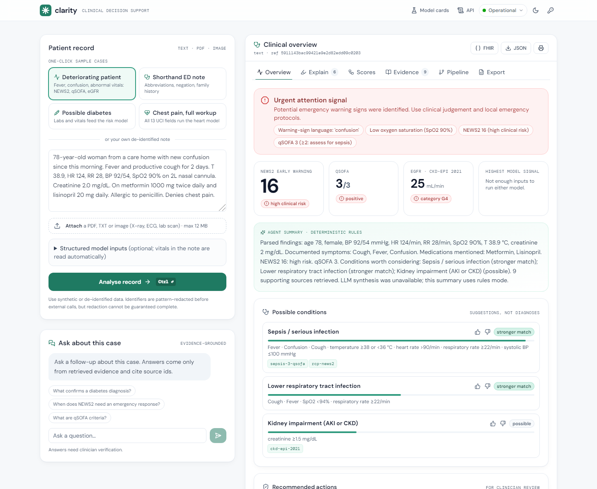
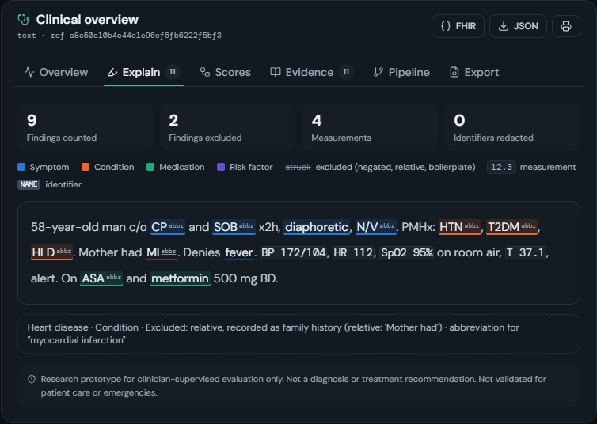
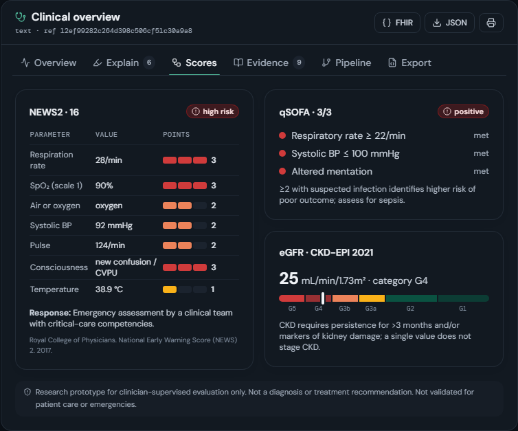
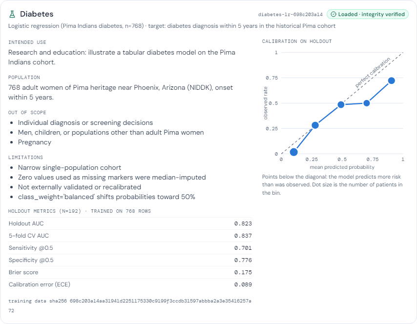
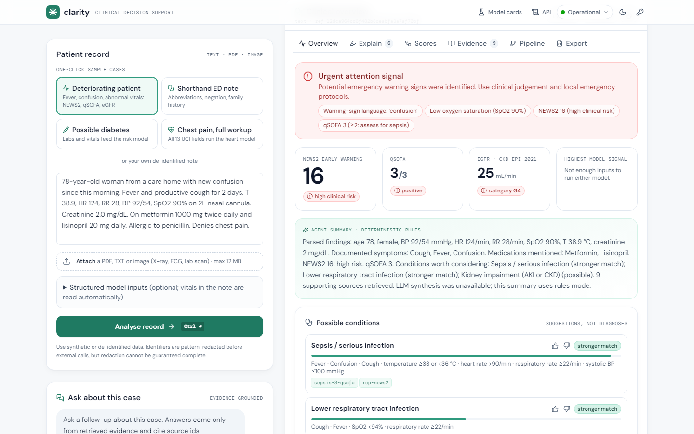
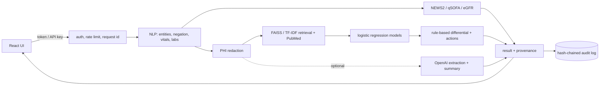

# Clarity

[](https://github.com/Mohhet-20/clinical-ai-assistant/actions/workflows/ci.yml)


Clarity reads a clinical note, lab PDF or image, and returns:
- the findings it extracted, each one explained
- early-warning scores (NEWS2, qSOFA, eGFR)
- next steps for a clinician to review, each citing evidence
- a FHIR R4 bundle

It's a research prototype, not a medical device. Use synthetic data only.

**[Live demo](https://clinical-ai-assistant-nine.vercel.app/)**: click *Run the deteriorating-patient case*. The API is on Render's free tier and sleeps when idle. While it wakes, the page shows a precomputed result, labelled as one.



## What it does

| | |
|---|---|
|  | **Explain**: the note as the pipeline read it. Each finding is either counted or struck through (negated, a relative's history, report boilerplate), and tapping it shows the trigger that decided. A test checks that these highlights always match the extracted data. |
|  | **Scores**: NEWS2 broken down per parameter, the qSOFA criteria, and eGFR (CKD-EPI 2021) on the KDIGO scale. If vitals are missing, the score is shown as a lower bound ("5+"), so a partial score never looks reassuring. |
|  | **Model cards**: intended use, limitations, holdout metrics and a calibration plot. The diabetes model over-predicts at the high end, so the UI calls its output a *signal*, not a risk. |
|  | Works from phone to desktop, in dark mode, and by keyboard. CI runs axe-core on every view in both themes. |

It also has:
- OIDC single sign-on, plus API keys for service accounts.
- Redaction of names, IDs and dates before anything leaves the server.
- An audit log that detects tampering, and an optional encrypted case history.
- Clinician Agree/Disagree feedback on each suggestion.
- Prometheus metrics, plus Kubernetes manifests for deployment.

## How it works



The agent is a three-step LangChain pipeline (understand the patient → fetch evidence → recommend), and the response includes the trace so you can see each step's timing. Every part works without an OpenAI key; it falls back to rules mode.

## Design decisions

- **Rules first, LLM optional.** The clinically important parts (negation, vitals, scores, urgent flags) are deterministic and tested. The LLM only drafts the summary and extraction, and only from redacted text. Its output is then checked: replies that prescribe or dose are rejected, and citations to sources it wasn't given are removed.
- **Published scores over my own models.** NEWS2 and qSOFA are validated and widely used. The two ML models are small logistic regressions trained on old public cohorts. They're shown as signals, with their limitations, and never drive urgency on their own.
- **Measure, don't assume.** `backend/eval/gold.jsonl` is a 43-case annotated set covering negation, abbreviations, family history and urgent cases. CI fails if any metric drops. Most of these cases come from bugs I found by trying to break the parser. For example, "pulse ox 89%" was being read as a heart rate, and "c/o SOB, CP" was missed.
- **Nothing identifiable leaves the server.** PubMed is only ever queried with recognised clinical terms, never free text. The tests use a fake LLM and a fake PubMed client and check exactly what each one received.
- **The audit log stores hashes, not notes.** Each record chains to the previous one, so `GET /v1/audit/verify` detects edits.

The full hazard log, with the control and test for each hazard, is in [docs/SAFETY_CASE.md](docs/SAFETY_CASE.md). Security controls and known gaps are in [SECURITY.md](SECURITY.md).

## Running it

Requires Python 3.10+ and Node 18+.

**Windows:** `.\setup.ps1` then `.\start.ps1`. The API runs at http://localhost:8000 and the UI at http://localhost:5173.

**macOS / Linux:**

```bash
cd backend
python3 -m venv .venv && source .venv/bin/activate
pip install -r requirements-dev.txt
cp .env.example .env
uvicorn app.main:app --reload --port 8000

# second terminal
cd frontend && npm install && npm run dev
```

**Docker:** `docker compose up --build`. The UI runs at http://localhost:8080.

Sample inputs are in `samples/` (two notes and a lab PDF, all synthetic). The UI also has one-click sample cases.

## Tests

```bash
cd backend
ruff check .
pytest -q --cov            # 112 tests, ~92% coverage
python evaluate.py --gate  # clinical quality gate

cd ../frontend
npm test                   # Vitest
npm run e2e                # Playwright, desktop + mobile, with axe (set E2E_PYTHON to the backend venv python)
```

The backend tests include attack cases:
- OIDC tokens with `alg: none` and HS256 key confusion
- spoofed uploads and tampered model files
- an edited audit log
- one user trying to read another user's case

CI also runs `pip-audit`, `npm audit`, the Docker builds with a smoke test, a Trivy image scan and an SBOM.

After changing the pipeline, run `python export_demo.py` to regenerate the offline demo results. A frontend test fails if they're out of date.

## API

Interactive docs are at `/docs`. The main routes:

| Route | |
|---|---|
| `POST /v1/analyze` | `{"text": "...", "risk_features": {...}}` → conditions, scores, actions, evidence, annotations |
| `POST /v1/upload` | multipart `file` (PDF, TXT, PNG, JPEG, WebP; up to 12 MiB) and/or `notes` |
| `POST /v1/chat` | follow-up questions answered from the retrieved evidence |
| `POST /v1/feedback` | clinician Agree/Disagree on a suggestion, written to the audit log |
| `POST /v1/fhir/bundle` | an analysis result → FHIR R4 Bundle |
| `GET /v1/models`, `/v1/evidence` | model cards, evidence catalogue |
| `GET /v1/cases[/{id}]` | encrypted case history, scoped to the owner (when enabled) |
| `GET /v1/audit`, `/v1/audit/verify`, `/metrics` | admin only |
| `GET /v1/health`, `/v1/ready` | liveness and readiness |

```bash
curl -X POST http://localhost:8000/v1/analyze -H 'Content-Type: application/json' \
  -d '{"text":"Fatigue and thirst. Glucose 182 mg/dL, BMI 33, age 45."}'
```

Unversioned paths (`/analyze` and so on) still work as aliases. Every error includes a `request_id` that matches the `X-Request-ID` header and the logs.

## Configuration

All settings are environment variables. `backend/.env.example` lists every one; the main ones are below.

| Variable | Default | |
|---|---|---|
| `OPENAI_API_KEY` | unset | Optional. Enables LLM extraction, summaries, chat, image transcription and embeddings. |
| `ENVIRONMENT` | `development` | `production` refuses to start without auth configured. |
| `API_KEYS` / `ADMIN_API_KEYS` | unset | Comma-separated keys for the clinician and admin roles. |
| `OIDC_ISSUER` / `OIDC_AUDIENCE` / `OIDC_CLIENT_ID` | unset | Turns on SSO. IdP roles map to Clarity roles via `OIDC_ROLE_CLAIM`, `OIDC_CLINICIAN_ROLE` and `OIDC_ADMIN_ROLE`. |
| `TRUSTED_PROXY_HOPS` | `0` | The number of proxies in front of the API, used to find the real client IP for rate limiting. Set it to `1` on Render or behind ingress-nginx. |
| `RATE_LIMIT_PER_MINUTE` | `60` | Requests per client per minute. `0` disables the limit. |
| `CASE_STORE` / `CASE_ENCRYPTION_KEY` | `false` / unset | Encrypted case history. The key is a comma-separated list of Fernet keys, and the first one encrypts. |
| `CASE_RETENTION_DAYS` | `30` | How long stored cases are kept. |
| `AUDIT_LOG_PATH` | `backend/logs/audit.jsonl` | Put this on persistent storage in production. |
| `PUBMED_LIVE` | `true` | Set to `false` for offline mode. |
| `CORS_ORIGINS` | localhost | The exact UI origins allowed to call the API. |
| `VITE_API_URL` | `http://localhost:8000` | The API URL for the frontend, baked in at build time. |

## Deployment

- **API on Render:** configured by `render.yaml`. Its free disk is wiped on every redeploy, so attach a persistent disk at `/app/logs` if you want the audit log to survive.
- **UI on Vercel:** set the root directory to `frontend/` and `VITE_API_URL` to the Render URL, and add the Vercel origin to the API's `CORS_ORIGINS`. Deploy the API first.
- **Kubernetes:** see `deploy/kubernetes/clarity.yaml`. Its header explains how to create the secrets it needs. It sets up:
  - the restricted Pod Security Standard
  - read-only containers
  - default-deny NetworkPolicies
  - a TLS ingress

## Data and limitations

| Data | Used for | Source |
|---|---|---|
| UCI Heart Disease, Cleveland (297 rows) | Heart model | CC BY 4.0, [10.24432/C52P4X](https://doi.org/10.24432/C52P4X) |
| Pima Indians Diabetes (768 rows) | Diabetes model | The upstream source and licence of this CSV aren't recorded. Check them before redistributing. |
| Guideline excerpts (16) | Retrieval | Source URLs in `backend/data/evidence.json` |
| PubMed abstracts | Retrieval | NCBI E-utilities. The publishers keep copyright. |

Known limitations:
- The models aren't externally validated, and the Pima cohort is narrow.
- The possible conditions come from transparent rules, not a diagnostic model.
- PHI redaction is pattern-based, so it can miss things.
- There's no OCR, so scanned PDFs need the vision model.
- The rate limiter and audit log are per process.

Don't put real patient data into it. The steps that would be needed before any clinical use are listed at the end of the [safety case](docs/SAFETY_CASE.md).

---

Built by [Mohhet-20](https://github.com/Mohhet-20). Questions and issues are welcome.
